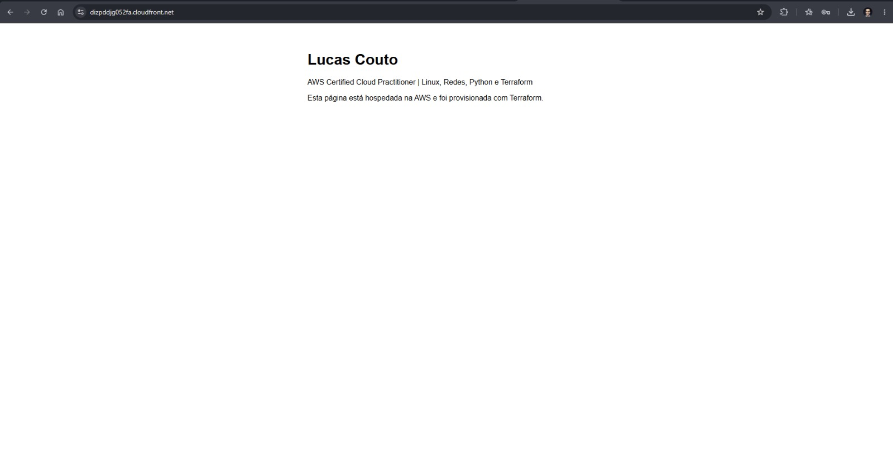
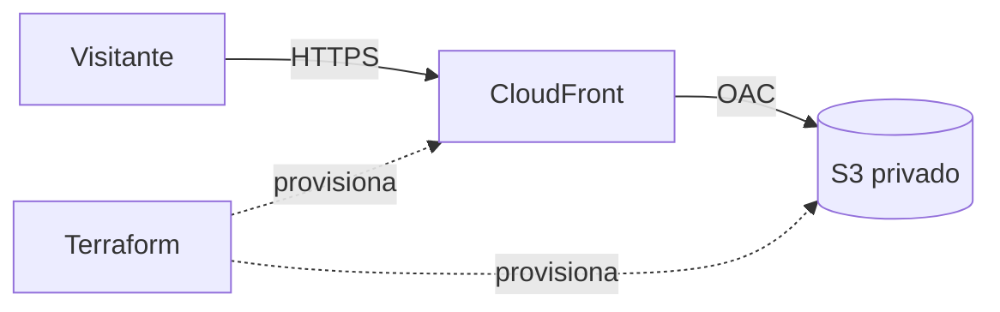
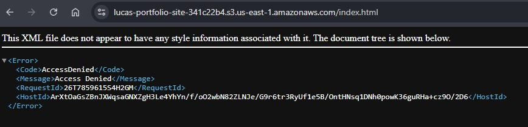

# Site estático na AWS com Terraform

Hosting de site estático na AWS com Terraform: S3 privado, CloudFront, IaC versionado e documentação passo a passo.



## Arquitetura



O bucket S3 é totalmente privado. Somente a distribuição CloudFront tem permissão de leitura, por meio de Origin Access Control (OAC) e uma bucket policy restrita ao ARN da distribuição. O acesso direto ao bucket retorna `Access Denied`.

## Evidências de segurança

O bucket é privado: o acesso direto ao endereço do S3 é negado, e o conteúdo só é entregue pelo CloudFront.

**Acesso direto ao bucket (bloqueado):**



## Tecnologias

- AWS: S3, CloudFront, IAM
- Terraform (providers `aws` e `random`)
- Git e GitHub

## Boas práticas aplicadas

- Bucket com bloqueio total de acesso público
- Acesso ao bucket somente via CloudFront (OAC)
- HTTPS obrigatório (redirecionamento de HTTP para HTTPS)
- Infraestrutura 100% como código, reproduzível
- Arquivo `.terraform.lock.hcl` versionado para fixar as versões dos providers
- Arquivos de estado e variáveis sensíveis fora do repositório (`.gitignore`)
- Credenciais fora do código, usando profile do AWS CLI definido no terminal

## Como reproduzir

Pré-requisitos: conta AWS, AWS CLI e Terraform instalados, e um usuário IAM configurado no CLI.

```bash
git clone https://github.com/coutolucasdev/aws-static-site-terraform.git
cd aws-static-site-terraform

# Confirme a conta antes de criar recursos
aws sts get-caller-identity

terraform init
terraform plan
terraform apply
```

Ao final, o Terraform exibe a `url_do_site`. A distribuição CloudFront leva alguns minutos para ficar disponível.

## Custo estimado

Para um site pequeno de estudo, o custo tende a ser muito baixo, e parte pode ser coberta pelo plano gratuito da AWS. Confira os preços atuais de S3 e CloudFront na página oficial da AWS. Um orçamento com alerta de gastos (AWS Budgets) está configurado na conta.

## Como remover tudo

```bash
terraform destroy
```

## O que aprendi

Vim de vendas e de treinamento de equipes, e gosto de explicar o que construo. Neste projeto, o ponto mais valioso foi entender o **porquê** de cada decisão: o bucket é privado para reduzir a superfície de ataque, o CloudFront entrega com HTTPS, e o Terraform versiona tudo para que qualquer pessoa reproduza o ambiente. Também reforcei o hábito de controlar custos (alerta de gastos e `terraform destroy`) e de resolver problemas lendo as mensagens de erro, como quando uma política da organização bloqueou minha primeira conta. Meu próximo passo é construir uma VPC do zero para aprofundar redes na AWS.

## Autor

Lucas Couto | AWS Certified Cloud Practitioner
[LinkedIn](https://www.linkedin.com/in/lucascoutoaraujo)